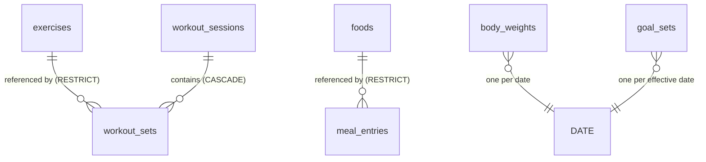

# Phase 1 Data Model: GymTracker v1

**Feature**: 001-gym-nutrition-tracker | **Date**: 2026-09-30 | **Store**: SQLite (single file)

SQLite is the single source of truth (Principle VI). Every validation rule enforced in
`src/validation/` has a mirrored `CHECK`, `NOT NULL`, `UNIQUE`, or foreign-key constraint here, so
that a service-layer bug cannot produce invalid persisted state.

## Conventions

- **Dates**: `TEXT` in `YYYY-MM-DD`. SQLite sorts and compares these lexicographically, which
  matches chronological order, so no date functions are needed for ranges.
- **Timestamps**: `TEXT` ISO-8601 UTC, written with `strftime('%Y-%m-%dT%H:%M:%fZ','now')`.
- **Masses and energy**: `REAL`. Kilograms for weight, grams for macros and food quantities,
  kcal for energy. Rounding happens once at the service boundary (research R4), never in SQL.
- **Soft state**: `archived_at TEXT NULL` — `NULL` means active.
- **Naming**: snake_case columns in SQL; repositories map them to camelCase at the layer boundary
  so that no SQL naming leaks into services, routes, or the API.

## Pragmas (applied on every connection in `src/db/connection.js`)

```sql
PRAGMA foreign_keys = ON;   -- OFF by default in SQLite; required for ON DELETE RESTRICT
PRAGMA journal_mode = WAL;
PRAGMA busy_timeout = 5000;
```

---

## Tables

### `schema_migrations`

Tracks applied migrations so the runner is idempotent and ordered.

| Column | Type | Constraints |
|---|---|---|
| `version` | INTEGER | PRIMARY KEY |
| `name` | TEXT | NOT NULL |
| `applied_at` | TEXT | NOT NULL |

---

### `exercises`

| Column | Type | Constraints |
|---|---|---|
| `id` | INTEGER | PRIMARY KEY AUTOINCREMENT |
| `name` | TEXT | NOT NULL, length 1–80 |
| `name_key` | TEXT | NOT NULL, **UNIQUE** — `lower(trim(name))` |
| `muscle_group` | TEXT | NOT NULL, CHECK in the muscle group enum |
| `archived_at` | TEXT | NULL |
| `created_at` | TEXT | NOT NULL |

`name_key` is a stored, lowercased copy of the name written by the repository on every insert and
update. It exists solely so that SQLite's `UNIQUE` index enforces the case-insensitive duplicate
rule of FR-002 at the storage layer rather than relying on a service-layer check.

Muscle group enum: `chest`, `back`, `legs`, `shoulders`, `arms`, `core`, `full_body`, `other`.

**Indexes**: `UNIQUE(name_key)`; `idx_exercises_active ON exercises(archived_at, name)`.

---

### `workout_sessions`

| Column | Type | Constraints |
|---|---|---|
| `id` | INTEGER | PRIMARY KEY AUTOINCREMENT |
| `session_date` | TEXT | NOT NULL, CHECK `date(session_date) IS NOT NULL` |
| `note` | TEXT | NULL, length ≤ 500 |
| `created_at` | TEXT | NOT NULL |

Multiple sessions per date are allowed (FR-011), so `session_date` is deliberately not unique.

**Indexes**: `idx_sessions_date ON workout_sessions(session_date DESC)`.

---

### `workout_sets`

| Column | Type | Constraints |
|---|---|---|
| `id` | INTEGER | PRIMARY KEY AUTOINCREMENT |
| `session_id` | INTEGER | NOT NULL, FK → `workout_sessions(id)` **ON DELETE CASCADE** |
| `exercise_id` | INTEGER | NOT NULL, FK → `exercises(id)` **ON DELETE RESTRICT** |
| `position` | INTEGER | NOT NULL, CHECK ≥ 0 — ordering within the session |
| `reps` | INTEGER | NOT NULL, CHECK > 0 |
| `weight_kg` | REAL | NOT NULL, CHECK ≥ 0 — zero is valid for bodyweight work (FR-007) |

The two cascade rules differ on purpose: deleting a session should remove its sets (they have no
independent meaning), while deleting a referenced exercise must be refused (research R7).

**Indexes**: `idx_sets_session ON workout_sets(session_id, position)`;
`idx_sets_exercise ON workout_sets(exercise_id)`.

---

### `body_weights`

| Column | Type | Constraints |
|---|---|---|
| `entry_date` | TEXT | **PRIMARY KEY** |
| `weight_kg` | REAL | NOT NULL, CHECK > 0 |
| `created_at` | TEXT | NOT NULL |
| `updated_at` | TEXT | NOT NULL |

The one-entry-per-date rule (FR-013) is the primary key itself, so duplicates are structurally
impossible. Writes use `INSERT ... ON CONFLICT(entry_date) DO UPDATE`, and the repository reports
whether the row was created or updated so the service can tell the user it replaced a value.

---

### `foods`

| Column | Type | Constraints |
|---|---|---|
| `id` | INTEGER | PRIMARY KEY AUTOINCREMENT |
| `name` | TEXT | NOT NULL, length 1–120 |
| `name_key` | TEXT | NOT NULL, **UNIQUE** — `lower(trim(name))` |
| `portion_name` | TEXT | NOT NULL, length 1–60 — e.g. `"1 medium egg"` |
| `portion_grams` | REAL | NOT NULL, **CHECK > 0** |
| `calories` | REAL | NOT NULL, CHECK ≥ 0 — per reference portion |
| `protein_g` | REAL | NOT NULL, CHECK ≥ 0 |
| `carbs_g` | REAL | NOT NULL, CHECK ≥ 0 |
| `fat_g` | REAL | NOT NULL, CHECK ≥ 0 |
| `is_builtin` | INTEGER | NOT NULL DEFAULT 0, CHECK IN (0,1) |
| `archived_at` | TEXT | NULL |
| `created_at` | TEXT | NOT NULL |

`CHECK (portion_grams > 0)` is what makes the servings→grams conversion in research R6 total: the
divide-by-zero state the spec worried about cannot exist in the database.

`is_builtin` marks catalog rows that ship with the seed. It affects presentation only — builtin
foods are edited, archived, and deleted by exactly the same rules (FR-042).

**Indexes**: `UNIQUE(name_key)`; `idx_foods_search ON foods(archived_at, name_key)`.

---

### `meal_entries`

| Column | Type | Constraints |
|---|---|---|
| `id` | INTEGER | PRIMARY KEY AUTOINCREMENT |
| `entry_date` | TEXT | NOT NULL |
| `meal_slot` | TEXT | NOT NULL, CHECK IN (`breakfast`,`lunch`,`dinner`,`snack`) |
| `food_id` | INTEGER | NOT NULL, FK → `foods(id)` **ON DELETE RESTRICT** |
| `quantity_g` | REAL | NOT NULL, CHECK > 0 — the single authoritative quantity (research R6) |
| `created_at` | TEXT | NOT NULL |

`servings` is never stored. It is an input alternative resolved to grams on write, and a derived
output (`quantity_g / portion_grams`) on read.

**Indexes**: `idx_meals_date ON meal_entries(entry_date, meal_slot)`;
`idx_meals_food ON meal_entries(food_id)`.

---

### `goal_sets`

| Column | Type | Constraints |
|---|---|---|
| `effective_date` | TEXT | **PRIMARY KEY** |
| `calories` | REAL | NOT NULL, CHECK ≥ 0 |
| `protein_g` | REAL | NOT NULL, CHECK ≥ 0 |
| `carbs_g` | REAL | NOT NULL, CHECK ≥ 0 |
| `fat_g` | REAL | NOT NULL, CHECK ≥ 0 |
| `created_at` | TEXT | NOT NULL |

One row per effective date (FR-025c), enforced by the primary key. The table *is* the goal history
— rows are never mutated in place except by an explicit upsert on the same effective date, so past
days keep their governing values (FR-025b).

---

## Relationships



`body_weights` and `goal_sets` have no foreign keys — they are date-keyed facts standing alone.

---

## Derived values (computed, never stored)

Storing these would create a second source of truth, which Principle VI forbids. Each has exactly
one owning module.

| Value | Formula | Owner |
|---|---|---|
| Entry nutrition | `foodValue × (quantity_g / portion_grams)` | `nutrition-math.js` |
| Entry servings | `quantity_g / portion_grams` | `nutrition-math.js` |
| Day totals | `SUM` over the day's unrounded entry values, rounded once | `nutrition.service.js` |
| Remaining | `goal − consumed`; negative means exceeded, flagged explicitly (FR-027) | `nutrition.service.js` |
| Governing goals for day *D* | greatest `effective_date <= D`, else `null` | `goals.service.js` |
| Session volume | `SUM(reps × weight_kg)` over the session's sets | `progress.repo.js` |
| Weekly volume | `SUM(reps × weight_kg)` grouped by ISO week | `progress.repo.js` |
| Exercise best | `MAX(weight_kg)` per session date for one exercise | `progress.repo.js` |
| Body weight net change | last − first in range | `progress.service.js` |

Volume uses the single definition fixed in the spec assumptions — `reps × weight`. Because
bodyweight sets store `weight_kg = 0`, they contribute zero volume; this is intentional and noted
in the UI rather than special-cased.

---

## Validation ↔ constraint matrix

Each row is covered by a unit test on the validator and an integration test on the constraint.

| Rule | Validator (boundary) | Database constraint |
|---|---|---|
| Exercise name non-empty, ≤ 80 chars | `text(1,80)` | `NOT NULL` |
| Exercise name unique, case-insensitive | service pre-check → 409 | `UNIQUE(name_key)` |
| Muscle group is a known value | `oneOf(...)` | `CHECK` |
| Reps a positive integer | `integer(min:1)` | `CHECK (reps > 0)` |
| Weight ≥ 0 | `nonNegativeNumber` | `CHECK (weight_kg >= 0)` |
| Session has ≥ 1 set | `minItems(1)` on `entries` | — (application rule; research R10) |
| Body weight > 0 | `positiveNumber` | `CHECK (weight_kg > 0)` |
| One body weight per date | upsert semantics | `PRIMARY KEY(entry_date)` |
| Portion grams > 0 | `positiveNumber` | `CHECK (portion_grams > 0)` |
| Quantity > 0 | `positiveNumber` | `CHECK (quantity_g > 0)` |
| Exactly one of servings/grams | `exactlyOneOf` | — (input-shape rule) |
| Meal slot is a known value | `oneOf(...)` | `CHECK` |
| Goal values ≥ 0 | `nonNegativeNumber` | `CHECK (... >= 0)` |
| Date is `YYYY-MM-DD` and real | `isoDate` | `CHECK (date(col) IS NOT NULL)` |
| Date not in the future | `isoDate({maxToday:true})` | — (relative to now; not expressible as a static CHECK) |
| Referenced exercise/food not deletable | service pre-check → 409 | `ON DELETE RESTRICT` |

The two rules with no database counterpart are the ones that genuinely cannot be static: "not in
the future" depends on the current date, and "at least one set" spans rows inserted in the same
transaction. Both are covered by tests at the layer that owns them.

---

## Seed data shape

Produced by `src/seed/generate.js` from today's date with a fixed-seed PRNG (research R9).

| Entity | Volume | Notes |
|---|---|---|
| `exercises` | 12 | Across 5 muscle groups; 1 pre-archived to demo archiving |
| `workout_sessions` | ~32 | 4 per week for 8 weeks, ending yesterday |
| `workout_sets` | ~400 | 3–4 exercises per session, 3–4 sets each, progressive loading |
| `body_weights` | ~56 | Daily for 8 weeks; gentle downward trend plus noise |
| `foods` | ~40 | `is_builtin = 1`; realistic portions and macros |
| `meal_entries` | ~500 | 6 weeks × 4 slots × 2–3 items |
| `goal_sets` | 2 | One 8 weeks ago, one 3 weeks ago — makes effective-dating visible in the demo |
